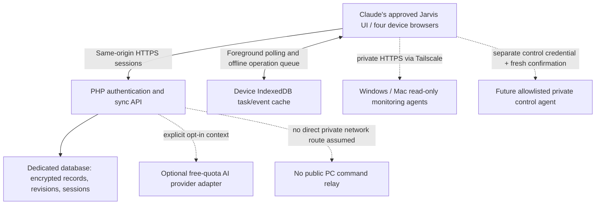

# Recommended architecture and migration boundary

## Decision

Use the already-paid hosting for a small, PC-independent **data backend**, subject to a separate origin, runtime validation and security review. Prefer PHP request/response plus MySQL for production, with an offline PWA and foreground synchronization. Keep AI inference optional and separately replaceable. Node.js is available on eligible Hostinger plans, but adding a persistent server/WebSocket dependency provides little value for four devices and shared lists.

The local prototype uses SQLite for executed tests. Its PDO MySQL schema and row-lock path need staging tests before production; this is not a claim of verified MySQL deployment. Shared hosting provides no sensible guarantee of an always-running local AI model or private tailnet daemon.

## Components

**UI:** Existing design remains owned by Claude. This branch adds an engineering console and API contract, not replacement dashboard assets. Eventual UI integration is a separate reviewed merge.

**Identity/backend:** One owner, separate per-device HttpOnly sessions with revocation and expiry. Same-origin deployment avoids fragile cross-site cookies between GitHub Pages and Hostinger. Use dedicated credentials/database, minimum privileges and server-only configuration. Prefer passkeys/MFA for the production personal assistant after a focused implementation review; the prototype currently provides password/session foundations only.

**Shared state:** Tasks, events and preferences are normalized records with server revisions. Clients preserve a durable pending queue, retry a stable operation ID after uncertain network outcomes and show 409 conflicts. Tombstones prevent offline devices resurrecting deleted entries. Do not garbage-collect them without a device checkpoint/retention design. A bounded full snapshot is simpler than a message broker for this workload. iOS background polling is not assumed; sync on foreground and reconnect.

**Memory:** Start with explicitly saved, small notes. No automatic recording of conversations, whole-device indexing or invisible model uploads. Encrypt records at rest; keep decryption keys out of code/webroots/backups where possible and back them up separately. Server-side encryption does not protect against an attacker controlling the hosting account. Offline tasks also need device protection; sensitive offline memory is excluded. Curated note selection is sufficient initially. No vector database or embedding service is required.

**AI engine:** A server-side adapter, disabled by default, may send a deliberately selected prompt/context to an approved free-quota endpoint. Fixed provider/model allowlists, request/token/output limits, timeouts, no paid fallback, no automatic attachments, explicit privacy choice and a hard failure state are necessary. Provider output is untrusted text or a proposal, never authority to operate devices. Keep free-service quota failures separate from task/backend availability. The prototype returns 501 and makes no inference calls.

**Speech:** Push-to-talk, review transcript, execute only known non-disruptive commands; installed speech synthesis for responses, with text fallback. Browser recognition may use an external service. Natural bilingual conversation additionally requires a model and language-quality testing. Do not equate dictation with reasoning. Never implement an always-listening browser wake word as a reliability promise on iPadOS.

**Monitoring:** Devices connect through the existing private Tailscale network to authenticated read-only agents. Browser activity in the prototype is labelled as session activity; it cannot establish PC power or CPU/GPU temperature. Hostinger is not assumed to be a tailnet member and cannot simply connect to a `100.x` host. Mac support requires an actual tested companion/packaging; no new monitoring agent is installed here.

**Controls:** A separate, disabled-by-default private service, separate credentials and allowlisted action IDs. No shell strings, arbitrary executable paths, public relay, router forwarding or Funnel. Disruptive actions require a foreground summary naming the device/action and a server-issued one-use challenge expiring within seconds; reject replay, background execution and offline queueing. Local authorization and signed audit events need review. Monitoring credentials and AI suggestions never authorize control. Nothing is activated in this prototype.

## Future authorized-service adapters

External calendar, email and other integrations belong behind a fixed connector registry with owner-approved OAuth scopes, exact redirect URIs, encrypted refresh tokens, timeouts and request budgets. Keep service credentials on the server; use explicit allowlists rather than a user-supplied URL proxy. Read access and write access are separate grants. Confirm externally visible or destructive actions and treat retrieved content as untrusted input, not tool authorization. No external account was connected or messaged by this prototype.

## Availability matrix

| Situation | Realistic behavior |
| --- | --- |
| Windows off, hosting and internet reachable | Shared data/auth/calendar/preferences work after backend deployment. Private PC telemetry/control is unavailable. Optional approved cloud AI can work within free quota. |
| Windows off, Mac awake with a configured local model | Local AI can be available privately through the Mac, subject to actual hardware/model tests. |
| Windows and Mac off, no approved cloud inference | Dashboard/data functions and simple deterministic commands work; generative conversation does not. |
| Internet absent | Previously cached UI, tasks/events and queued edits work on a trusted device. Synchronize later. Fresh shared state, API login, cloud AI and guaranteed speech recognition do not. |
| Hosting or provider down | Device cache continues; data sync or AI fails explicitly. “Always available” means independent of the PC, not an absolute uptime guarantee. |

## Migration and rollback

1. Keep the current website, emails, DNS, scheduled jobs, dashboard origin and all backups unchanged during audit. Export the existing Jarvis JSON backup manually on each device; reconcile duplicate local tasks before selecting a canonical import. No automatic transfer of localStorage across origins is possible.
2. Complete review of the additive branch. Obtain approval for a named **new staging subdomain/root and dedicated database**; do not repurpose the beauty site's `public_html`. Confirm Hostinger entitlement, PDO/sodium activation, HTTPS, database limits and cache/CDN exclusions there. No SSH activation is needed for the audit.
3. Create fresh server-only secrets and an owner identity through a controlled local/admin channel. Use synthetic fixtures first. Do not connect real AI keys or personal memory until privacy choices and hardening are reviewed. Validate the MySQL adapter on the actual server.
4. Package Claude's approved static UI with the reviewed client adapter on the same new origin. The prototype's `/api/v1` contract allows independent integration. Keep GitHub Pages as a static fallback. Do not overwrite Claude's main branch or merge UI and backend without review.
5. Take a new downloadable file/database backup immediately before deployment, separately protect encryption keys, and restore into an isolated test target. Host backups exclude some archives/cache/export files; do not assume a ZIP in the webroot is protected. Backups and restore drills must avoid unrelated account sites.
6. Import the chosen backup once, verify tasks/calendar/preferences across all devices, then test logout/revocation, offline conflict/retry, physical Safari cookies and voice consent. Add device monitoring separately; control remains disabled.
7. For rollback, freeze writes, retain pending device queues and take a new data snapshot before changing code. Revert only Jarvis's isolated release directory; keep the database schema and data if compatible. Do not reset the database or delete queues to fix a UI issue. If a database restore is required, export newer data first and reconcile newer client operations explicitly. Never re-import a stale backup silently.
8. Revert only the new subdomain's routing if necessary; preserve the beauty site's original DNS, MX records and webroot. The original Pages dashboard remains available, but its origin-specific local lists do not automatically include newer cloud edits. Restore/merge a deliberate export rather than assume the old origin is synchronized.

Reference concepts: local System Design Primer availability/cache/asynchronism sections; local pgvector README demonstrates that vector search requires a suitable Postgres environment and does not justify adding one to this small PHP/MySQL system. No reference implementation copied.
